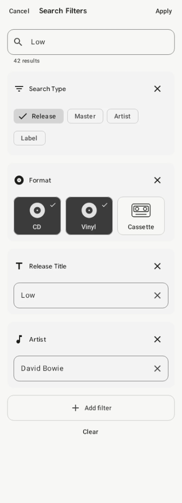

The cover looks right, the artist is right, and the search still leaves me with a long list of possible records. I would rather narrow that list with something I can read on the copy beside me than keep opening similar-looking covers.

My Vinyl's Search Filters let you separate an artist, release title, and format, then add identifiers when you need them. This guide follows the Android beta's screen code, English labels, and search logic. The public release history also notes recent work on opening search filters, but the steps below are Android-specific, not a claim that every iPhone control matches.[1]

The aim is a manageable shortlist. A search result is a candidate to check against your record, not an automatic verdict about which pressing you own.

## Start with facts you can read

Before opening the app, look at the jacket and label for the artist, album title, label name, and catalog number. Keep the record in its sleeve while reading the packaging. I would leave uncertain details out of the first search rather than add a guessed country or year.

Numbers need particular care. The Library of Congress's MARC 028 standard distinguishes an issue number from a matrix number and records the source of the number separately.[2] For this workflow, copy the printed catalog number as it appears on the release. Do not treat a longer inscription near the runout as an interchangeable answer for the Catalog number field.

I would also keep a spine number and a label number separate in my working notes if they differ. The same standard allows qualifying information about where a number appears.[2] You do not need to become a cataloger to use the practical lesson. Preserve what you found and where you found it before deciding which search field it belongs in.

## Build the basic search first

The Android composer divides its fields into basic and advanced groups. Search Type, Format, Release Title, and Artist are basic filters. Start there before considering the paid advanced fields, especially when your first problem is simply that the results include the wrong format.

Use this sequence for a record on the table:

1. Open Search and tap the search entry field. The Search Filters sheet opens with Cancel and Apply at the top.
2. Enter the album or artist in the main query field. Check any filters already visible before adding more.
3. Tap Add filter and choose Search Type. Select Release for this workflow.
4. Use Add filter again to add Format, then select Vinyl. If another format is already selected, tap it to remove that selection.
5. Add Artist or Release Title when the main query is ambiguous. Put the known name in its own field rather than piling more words into the query.
6. Read the selected values, then tap Apply to run the search and close the sheet.

I would add only the fields that solve the current problem. A separate Artist field helps distinguish a common album title. A Format filter addresses a different uncertainty. Filling every available box makes it harder to see which assumption excluded the record you wanted.

{: width="400" }

*An actual Compose render with example data, not a live search. The 42-result count is a test value. Both CD and Vinyl are selected here, so deselect CD for a vinyl-only search.*

## Add one identifier when the list stays broad

Catalog number, Barcode, and Label are among the advanced fields in the Android composer. Advanced search requires premium access in the app's feature policy. A locked field leads to the upgrade flow, so the basic procedure does not depend on those controls being available.

If you have access, add Catalog number and enter the printed identifier you recorded. Add Label if you know it, but avoid combining that with an uncertain country or year just to make the count smaller. The useful test is whether a detail is supported by the object, not whether it removes enough results.

Barcode is another possible starting point for a packaged release. GS1 defines a Global Trade Item Number as an identifier for a trade item, meaning a product or service that can be priced, ordered, or invoiced.[3] That is product identification, not a condition assessment of your individual copy. I would still compare the returned entry with the actual record.

The Android Barcode text field flags entries whose digit count is not 8, 12, 13, or 14. That check is not a pressing authentication test. If you cannot read the number, leave it out rather than supply missing digits to satisfy the field.

## Treat the count as a preview

While you edit, the composer can show a matching-results count below the query. The search logic requests that count after typing pauses. It does not replace the results behind the sheet until you apply the draft.

A changing count can help you notice an overly restrictive choice. It cannot establish that the remaining entries are correct. If the count is still loading, wait before comparing it with the previous value. If the request fails, the count can disappear, which is different from a confirmed zero.

Apply commits the draft to the active search. Cancel discards the sheet's uncommitted changes. That distinction lets you try a narrower combination without accepting it, but do not mistake a count preview for a completed search you can inspect.

## Broaden an empty search deliberately

When a search returns nothing, I would remove the least certain restriction first. Reopen the composer, remove the guessed year or country with that module's clear control, and apply again. Keep the artist and title you can verify while testing the uncertain part.

Clear inside the composer removes the filter modules but keeps the main query. The Clear action on the results screen resets the search filters and query together. Those controls have different scopes, so check the query before assuming you have started again from an empty search.

The app also saves applied filter preferences. If an unrelated album search behaves strangely later, inspect those settings before rewriting the title several times. A remembered format can be useful. A forgotten restriction can hide the result you need.

## Check the record before keeping the result

Open a promising result and compare its details with the copy beside you. Check the artist and title, then the format and identifiers you actually used. If something conflicts, return to the shortlist rather than explain away the difference because the artwork looks familiar.

Once you have the right collection entry, physical condition is a separate job. The Journal's [guide to saving record and sleeve conditions in My Vinyl](/blog/2026/11/my-vinyl-record-sleeve-conditions/) explains how to document those two assessments. Neither a matching barcode nor a short result list tells you how this copy plays.

Take one unresolved record today and run the basic search before adding advanced fields. Stop when you have a candidate you can check against the object. The useful result is an entry you can explain, not merely a search count reduced to one.

## Sources

[1] [My Vinyl+: Release history, including search-filter opening improvements in version 4.5.1](https://myvinyls.app/changelog/)

[2] [Library of Congress: MARC 21 bibliographic field 028, publisher or distributor number](https://www.loc.gov/marc/bibliographic/bd028.html)

[3] [GS1: Global Trade Item Number, definition and identification scope](https://www.gs1.org/standards/id-keys/gtin)
