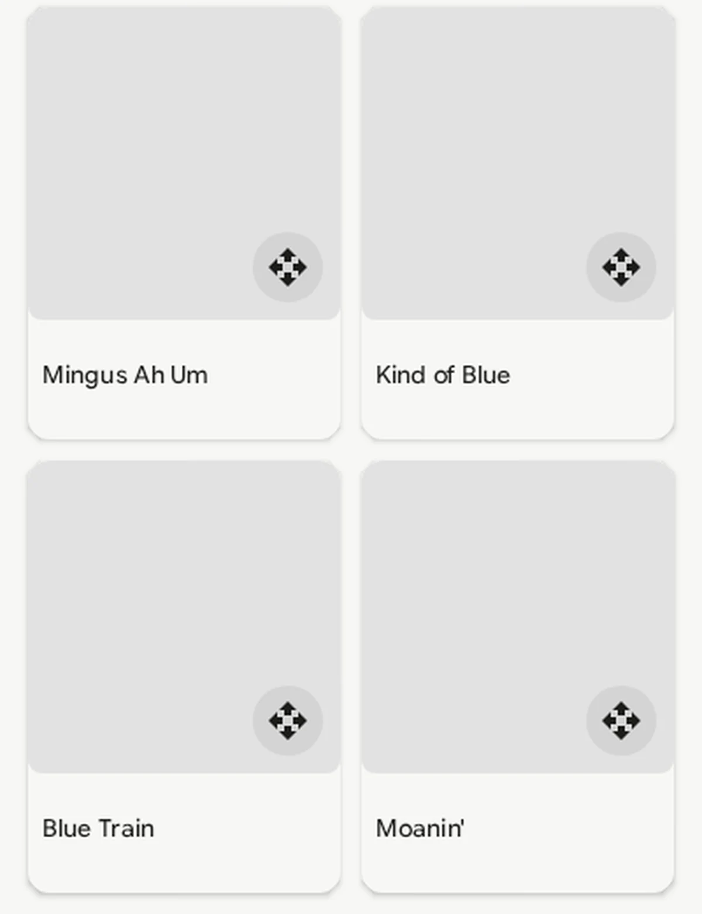

My shelf does not always follow the alphabet. I might keep a few related albums together or put the records I want to revisit at the front of a folder. Sorting by title cannot describe that choice. My Vinyl's Custom order can.

The useful distinction is between changing where a collection copy belongs and changing where it appears in a list. Arrange records does the second job. I would test it with a few familiar entries before trying to reproduce a whole shelf.

My Vinyl has a separate Android release history.[1] This walkthrough follows the current Android implementation and its English labels, checked against the collection screen, arrangement logic, and local storage code. It does not establish that every installed version already has these controls, or that the iOS screens are identical. If Arrange records is absent, check your version before following the steps.

## Choose the folder before the order

Open Collection and choose either All or an ordinary collection folder. Custom arrangements belong to that destination and the signed-in account. A custom order for one folder is separate from the order for All, so decide which view you want to maintain before moving artwork.

Smart Folders are different. The current implementation does not offer custom order for those automatically selected groups. If you are browsing a genre or decade group and cannot find Arrange records, return to All or an ordinary folder first.

I would start with a small folder whose contents I recognize. If you need to change which copies belong in it, use the Journal's [guide to creating folders and moving records](/blog/2026/11/my-vinyl-manage-folders/) first. Arranging the entries will not transfer them to another folder.

## Make one change in Arrange records

The sort chip above the records shows the current sorting choice. Its menu includes Custom order and Arrange records when the current destination supports them. Those choices have different purposes. Custom order displays a saved arrangement, while Arrange records opens the editing grid.

Use this sequence for a first attempt:

1. Select the intended collection folder and clear any search or format filter so you can inspect its contents without hiding entries.
2. Open the sort menu and choose Arrange records. The top bar changes to that name and offers Done and a close control.
3. Find one familiar record. Touch and hold its artwork, then drag it to a different position in the grid.
4. Check the neighboring titles before making another move. You are editing a draft at this stage, not saving each drag separately.
5. Tap Done to save the arrangement and activate Custom order for that destination.
6. Return to the same folder and check that the record appears where you intended.

There is a reason to clear the filters first. Arrange records includes the destination's copies without applying the browsing search or format filters. Entering from a narrow search can therefore reveal records that were not visible a moment earlier. That is not evidence that the app added anything.

## Use Move when dragging is awkward

Dragging is not the only control. Each card in the arrangement grid has a Move button, drawn as arrows pointing in four directions. Tap it to open the position menu.

The English choices are Move to start, Move earlier, Move later, and Move to end. Earlier and later shift a copy one place. Start and end take it to the corresponding edge of the arrangement, so I would use those for a large jump rather than drag through several rows.

An action that cannot change the current position is disabled. For example, a copy already at the start cannot move earlier. The component also supplies the available movement commands as accessibility actions and exposes the copy's position within the order.

*Arrangement grid from a real Android Compose test render, cropped to the cards. The gray artwork areas are test placeholders, not a photographed collection. The toolbar and movement menu are outside this example.*

## Save deliberately, or cancel the experiment

Done saves the draft order. The close control cancels it, and Android Back also leaves Arrange mode without saving the draft. That makes a small trial useful. Move one card, cancel, and confirm that the previous arrangement remains before committing to a longer edit.

Changing to a regular sorting option does not delete the saved arrangement. The app marks it inactive while you browse with the regular sort. Choose Custom order again to return to the stored sequence.

The direction control is absent while Custom order is active. That is intentional. Your saved sequence is the order, rather than an ascending or descending interpretation of a title or date field. To reverse part of it, edit those positions in Arrange records.

## Know what stays on this device

The Android implementation saves custom arrangements locally, separated by account and folder. They do not follow the collection to another device. I would not spend an evening reproducing a detailed shelf sequence on one phone and assume a second phone will show it automatically.

The order also identifies individual collection copies, not just album titles. Two copies of the same release can retain separate positions. Similar artwork still makes them easy to confuse, so check the entries before using the order to represent a physical filing system.

New copies that are not already in the saved sequence appear after the arranged copies. When several are new to that order, the implementation puts them in date-added order, oldest first. Removed copies no longer occupy visible positions. After adding records, reopen Arrange records if you want the newcomers somewhere other than the end.

## Check the shelf, not just the screen

If the arrangement represents a real shelf, choose one reading direction and keep it consistent. I would read the physical jackets left to right and match that sequence in the grid. Do not treat a screen position as a permanent location number if you expect to insert records between existing entries.

The Canadian Conservation Institute identifies lost accession numbers or associated information as a dissociation risk for recorded media.[2] A home collection does not need an institutional numbering system to borrow that lesson. Keep a written location reference if the exact filing arrangement matters, rather than relying on a device-local sequence alone.

Physical storage still takes priority. The Library of Congress recommends upright storage and sturdy dividers that support grooved discs in their sleeves.[3] Keep jackets supported while checking the order instead of emptying a shelf into a flat sorting pile.

Choose one folder now, place one record where you want it, and tap Done. Then retrieve that record using the resulting order. If the screen helps you find the copy without guessing, finish that folder before starting another.

## Sources

[1] [My Vinyl+: Android release history](https://myvinyls.app/changelog/android/)

[2] [Canadian Conservation Institute: Caring for audio, video and data recording media, theft, vandalism, and dissociation](https://www.canada.ca/en/conservation-institute/services/preventive-conservation/guidelines-collections/caring-audio-video-data-recording-media.html#a2b2)

[3] [Library of Congress: Care, Handling, and Storage of Audio Visual Materials](https://www.loc.gov/preservation/care/record.html)
